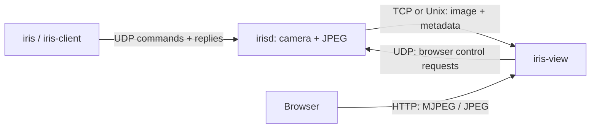

# Iris daemon and camera control

`irisd` owns capture and listens for UDP camera commands. `iris` is the typed
client CLI. The optional `iris-view` process receives image postcards and serves
the browser preview. The camera daemon builds and runs without HTTP dependencies.

## Libraries and applications

- `crates/photon-protocol`: versioned commands/replies, shared settings/status
  models, and framing for image postcards (JPEG plus metadata). No socket or HTTP
  dependency. `iris-api` remains a compatibility re-export for earlier callers.
- `crates/iris-client`: typed async commands over native UDP, or HTTP to the
  viewer gateway for browser/web applications. A UDP-only build needs no Reqwest.
- `crates/iris`: `irisd`, `iris`, and `iris-view`, selected by separate features.
  The public `Transmitter` trait lets processing output use different adapters.



The [client library guide](../crates/iris-client/README.md) covers native and
browser use. The preview remains available without building a custom browser UI.

## Build and install

Install the native CLI on your workstation as a normal user:

```bash
just install-iris
# Equivalent:
cargo install --locked --path crates/iris --bin iris --no-default-features \
  --features iris-client --root ~/.local --force
```

This installs `~/.local/bin/iris` without libcamera or the daemon. Ensure
`~/.local/bin` is on PATH, then use `iris config` and `iris camera <name> ...`
from any directory. The standard Cargo default is `~/.cargo/bin`; `--root ~/.local`
selects the user-local utility directory instead. Override the recipe's root with
`just install-iris /another/prefix` when needed.
Run `iris --version` to print its Cargo package version. Re-running the install
recipe rebuilds and replaces the utility, including when the version is unchanged.

Build the ARM daemon and installation bundle separately:

On the development host:

```bash
export IRIS_ARTIFACT_DIR=out/iris-daemon
just build
just deploy-iris
```

The artifact directory includes `irisd`, `iris`, `iris-view`, both systemd units
and environment files, `install-irisd.sh`, and the capture/benchmark examples. The deploy recipe copies the
install bundle to `/tmp/iris-install` on the Pi (default `192.168.50.150`).

Stop any previous manually launched camera process before installation, so it
does not hold the camera or preview port. Use SIGTERM and wait for it to exit.
Then, on the Pi:

```bash
sudo bash /tmp/iris-install/install-irisd.sh
iris status
```

The installer checks that all three binaries run with the Pi's libraries, installs
binaries atomically under `/usr/local/bin`, creates the `iris` system account,
and installs/enables/restarts `irisd.service` and `iris-view.service`. The service has camera access via
`video` and `render` groups. Existing `/etc/iris/irisd.env` is preserved on upgrades, with a default
`IRIS_TRANSMIT=tcp://127.0.0.1:9001` added if missing. `/etc/iris/iris-view.env`
is created once and preserved thereafter.
The libcamera shared libraries are external prerequisites; this script does not
replace them.

To install without enabling or starting, use `--no-start`. To inspect a package
without root or system changes, use `--destdir /tmp/iris-package`.

## Client configuration and camera commands

Save the connection once on the client machine:

```bash
iris config front --endpoint udp://192.168.50.150:8081
iris ping front
iris camera front status
iris camera front start
iris camera front set --exposure-us 59000 --gain 1.5
iris camera front stop
```

`iris config` with no arguments creates or updates a `default` profile, using
localhost when there is no saved endpoint. `iris show` displays the saved TOML
without changing it or connecting to the daemon; `iris config --show` remains
available. The default path is `$XDG_CONFIG_HOME/iris/config.toml`
or `~/.config/iris/config.toml`. Override it with `--config <path>` or `IRIS_CONFIG`.

Example file:

```toml
[cameras.front]
endpoint = "udp://192.168.50.150:8081"

[cameras.rear]
endpoint = "udp://192.168.50.151:8081"
```

Names are connection aliases for the camera owned by each daemon. Each daemon
currently captures one selected sensor. Adding a profile does not create another
capture worker or switch sensors on a daemon. Multiple aliases can refer to the
same daemon. Use letters, digits, `-`, `_`, or `.` in names.

Config saves preserve other camera profiles and replace the file atomically with
Unix mode 0600. Only endpoints are needed. Old `token_file` entries are ignored
without reading the referenced file, and removed the next time config is saved.
Malformed configuration is reported and preserved. Connection flags/environment
can override a profile's endpoint for a command.

For local use on the Pi, configure its own alias without credentials:

```bash
iris config local --endpoint udp://127.0.0.1:8081
iris camera local status
iris camera local set --fps 15 --jpeg-quality 85
iris camera local set --auto-exposure --auto-gain
```

`iris ping` sends a small Photon ping command to the default connection. Use
`iris ping front` or `iris camera front ping` for a named profile. It prints
`pong <endpoint> (<round-trip> ms)` on success. This checks the control service
without starting, stopping, or inspecting capture. UDP requests retry for up to
12 seconds; saved HTTP profiles instead use the viewer's `/ping` route, which
returns HTTP 204 after confirming the daemon's UDP reply.

The original `iris status`, `iris start`, `iris stop`, and `iris set` remain
compatible: they use the saved `default` profile or localhost when it is absent.

`iris stop` stops and releases the camera; it leaves the daemon available for the
next `iris start`. Start/stop are serialized and idempotent. Starting a failed
capture reaps the old worker before reacquiring the camera. An unexpected worker
failure remains visible until explicit recovery; there is no automatic retry
loop changing sensor state.

`iris set` validates the whole patch before accepting it. Exposure, gain, FPS,
and JPEG quality apply during capture, without restarting the daemon or camera.
Changes reach the sensor through subsequent capture requests and may take several
frames to appear. `requested_settings` describes desired values; actual exposure,
gain and frame duration are in `camera.latest_frame`. A successful command is
acceptance of the requested settings, not confirmation that hardware applied them.
Sensor limits may clamp settings; check actual metadata and `camera_state`.

Width, height, and camera index require stopped capture:

```bash
iris camera front stop
iris camera front set --width 1280 --height 720 --camera-index 0
iris camera front start
```

The fixed frame duration is the larger of `1_000_000 / fps` and manual exposure
plus 2000 microseconds. FPS is therefore a requested maximum when exposure needs
more time, and sensor mode constraints can further limit it.

The validated manual baseline is exposure 59000 us and gain 1.5. Longer exposure
can increase motion blur and reduce frame rate. Gain increases brightness with
additional noise. The previous clean-start 75000 us test failed; live updates do
not establish that this exposure is now supported.

## Persistent defaults and service management

Runtime `iris set` changes persist through camera stop/start, but not daemon
restart. Edit `/etc/iris/irisd.env` to change boot defaults:

```bash
sudoedit /etc/iris/irisd.env
sudo systemctl restart irisd
sudo systemctl stop irisd
sudo systemctl start irisd
systemctl status irisd
journalctl -u irisd -f
```

Defaults are 1280×720, exposure 59000 us, gain 1.5, requested FPS 30, JPEG quality
85. Capture starts automatically unless `IRIS_IDLE=true` is set. The daemon runs
in the foreground, handles SIGTERM/Ctrl-C, and waits for capture cleanup on exit.
The unit restarts a failed daemon process, with rate limits; stopping just the
camera intentionally does not trigger a service restart.

## UDP commands and image postcards

Commands are unauthenticated UDP datagrams on port 8081. The first protocol
version uses bounded UTF-8 JSON; raw Rust struct memory is never sent. Example:

```json
{"version":1,"request_id":42,"command":{"type":"start"}}
```

Command types are `ping`, `status`, `start`, `stop`, and `settings`. A settings
command carries a `settings` object with the existing `SettingsPatch` fields.
Each reply echoes `version` and `request_id`; `result.type` is `pong`, `status`,
or `error`. Status data is under `result.data`; errors contain a code (`invalid`,
`conflict`, or `unavailable`) and message there.

The native client retries the identical packet every 400 ms for up to 12 seconds.
The daemon caches the last 256 responses for up to 30 seconds, keyed by source
address/port and request ID. An exact duplicate returns its cached reply; reusing
an ID with different bytes is rejected. This handles normal lost replies but
does not promise exactly-once execution after cache eviction or process restart.
A timeout leaves the command outcome unknown; inspect status before deciding
what to do next. Await replies before sending dependent commands: UDP does not
preserve ordering. A successful start acknowledges the request; advancing frames
confirm that the hardware actually started.

Commands are limited to 1200 bytes and replies to 4096 bytes. Malformed, oversized,
unknown-command, and unsupported-version datagrams are discarded without changing
capture. Settings values are validated by the same serialized controller.

An image postcard contains JPEG bytes plus `FrameMetadata`. TCP and Unix streams
use this 16-byte header, followed by JSON metadata and then the raw JPEG payload:

| Offset | Field | Encoding |
| --- | --- | --- |
| 0 | Magic `PHTN` | 4 bytes |
| 4 | Protocol version, currently 1 | big-endian u16 |
| 6 | Image encoding, 1 = JPEG | big-endian u16 |
| 8 | Metadata byte length | big-endian u32 |
| 12 | JPEG byte length | big-endian u32 |

Metadata is limited to 16 KiB and a JPEG to 32 MiB; the receiver checks lengths
before allocating. Stream reads handle partial packets and consecutive frames.
Metadata timestamps are preserved unchanged. The metadata `pixel_format` describes
the source camera output (NV12); the header identifies the transmitted JPEG.
The word postcard here names the image message, not the Rust `postcard` codec.

`Transmitter::transmit(&mut self, &ImagePostcard)` is implemented by
`TcpTransmitter` and `UnixTransmitter`. Output runs outside capture, with one
latest-frame slot, bounded connect/write waits, and reconnection. Slow or absent
receivers can miss frames; they do not stall capture or grow an application queue.
Failed partial stream writes discard that connection to preserve framing.

Manual processes (separate terminals):

```bash
cargo build --bin irisd --features iris-service
cargo build --bin iris-view --bin iris --features iris-view,iris-client
iris-view --listen tcp://127.0.0.1:9001
irisd --idle --transmit tcp://127.0.0.1:9001
iris --endpoint udp://127.0.0.1:8081 start
```

For Unix sockets use the same `unix:///absolute/path/images.sock` endpoint for
`iris-view --listen` and `irisd --transmit`. Start the viewer first; the transmitter
will also reconnect if it starts earlier. Existing socket paths are never removed
at bind time; an orderly viewer shutdown removes only its own socket.

Installed services have separate private `/tmp` namespaces. Use
`unix:///run/iris-view/images.sock` for both services: `iris-view.service` creates
that runtime directory. Edit `IRIS_VIEW_LISTEN` and `IRIS_TRANSMIT` in their
respective environment files, then restart both units.

To run headless, use `irisd --no-transmit` or set `IRIS_NO_TRANSMIT=true`, and
disable the optional viewer with `sudo systemctl disable --now iris-view`.
A daemon with no `--transmit`/`IRIS_TRANSMIT` also has no image output.

## HTTP live view and browser control

Preview remains available at:

- `http://192.168.50.150:8080/stream.mjpg`
- `http://192.168.50.150:8080/frame.jpg`
- `http://192.168.50.150:8080/status` (camera metadata)

`iris-view` hosts preview HTTP on TCP port 8080 and browser control HTTP on TCP
port 8081. `irisd` owns UDP port 8081, so these listeners can use the same port
number independently. The default postcard stream uses TCP loopback port 9001.

Saved `http://...:8081` profiles still work through the gateway; direct native
clients should use `udp://...:8081` to control capture independently of the viewer.
Browsers use HTTP through the gateway because they cannot open ordinary UDP
sockets. Existing token-file entries are ignored; this home-development setup
uses no command credentials. Old `IRIS_BIND` settings belong to the earlier
combined daemon; configure `IRIS_VIEW_BIND` in `/etc/iris/iris-view.env` instead.
For custom command bind addresses/ports, set `IRIS_VIEW_COMMAND_ENDPOINT` to a
reachable matching UDP address, and adjust the viewer's HTTP ports as desired.

The gateway checks freshness using local time since image receipt. It closes
streams when its publisher disconnects or no fresh frame arrives for two seconds;
this does not equate remote clocks or measure optical end-to-end latency.
Restarting `iris-view` leaves `irisd` capture running, and images reconnect.

Control routes:

| Method | Path | Result |
| --- | --- | --- |
| GET | `/ping` | Empty 204 connection check; no capture changes |
| GET | `/status` | Camera metadata, requested settings, capture worker state |
| POST | `/camera/start` | Start capture, return current state |
| POST | `/camera/stop` | Wait for camera cleanup, return stopped state |
| PATCH | `/settings` | Validate and queue a settings patch |

Mutations require `X-Iris-Control: 1` to prevent browser cross-origin simple
requests from controlling a local daemon. The client supplies it automatically.
For example:

```bash
curl -H 'X-Iris-Control: 1' -H 'Content-Type: application/json' \
  -X PATCH -d '{"gain":1.5}' http://127.0.0.1:8081/settings
```

Invalid values return 400; geometry changes during capture return 409. Missing
or malformed JSON is rejected by the API. Capture errors are reported as `Failed`;
preview responses reject stale/unhealthy frames with 503. Camera status includes
`Stopped`, `Starting`, `Running`, `Stopping`, `Degraded`, and `Failed`.

## Validation

Non-hardware tests:

```bash
cargo test --workspace --features gmsl-picam-rs/iris-view,gmsl-picam-rs/jpeg-support,gmsl-picam-rs/iris-client
```

On an idle Pi with all three binaries in the provided directory:

```bash
python3 scripts/check-photon-stack.py /tmp/iris-install
# Isolate transport/restart validation at the established camera baseline:
python3 scripts/check-photon-stack.py /tmp/iris-install --restart-baseline
python3 scripts/check-iris-restart.py /tmp/iris-install/irisd
# On a separate host, against an idle daemon:
python3 scripts/check-iris-remote.py target/debug/iris \
  --address 192.168.50.150:8081
```

The stack check tests UDP commands and settings validation, image metadata and
JPEG delivery, both TCP and Unix transmitters, viewer restart/reconnection during
capture, live controls, stale-image rejection, camera stop/start, and SIGTERM
cleanup. It reports daemon/viewer CPU and delivered frame rate separately. The
restart check exercises the HTTP-free daemon through two full capture sessions.

The default stack check restarts capture at its live-test settings (45000 us,
gain 2.0). On 2026-11-18 that restart failed after otherwise healthy capture.
The explicit `--restart-baseline` variant restores 59000 us / gain 1.5 before
stop/start; both TCP and Unix runs passed with that option. It preserves the
original regression check rather than treating the 45000 us failure as resolved.
