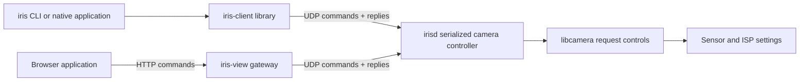

# Journey of a photon

From the scene, through the IMX477 and GMSL link, to an Iris image in a browser.

Documented: 2026-11-17; updated for the UDP/viewer split on 2026-11-18. This describes the Raspberry Pi 5 / Arducam IMX477 setup
used by this repository. Exact serializer/deserializer part numbers and board
wiring still need confirmation from the hardware documentation.

A photon contributes to the sensor's electrical signal when it is detected.
After that, the journey continues as information: charge, voltage, digital pixel
values, packets, image buffers, and compressed bytes. A displayed pixel combines
measurements from many photons and processing stages.

## The whole path

```mermaid
flowchart LR
    A[Light → lens] --> B[IMX477 pixel array + ADC]
    B --> C[Raw Bayer → serializer]
    C --> D[GMSL cable]
    D --> E[Deserializer]
    E --> F[MIPI CSI-2 → Pi 5 RP1 CFE]
    F --> G[PiSP image processor]
    G --> H[NV12 frame buffers]
    H --> I[irisd: JPEG encoding]
    I --> J[TCP or Unix: JPEG + metadata postcard]
    J --> K[iris-view: HTTP MJPEG → browser]
```



On Pi 5, the receiver and ISP front end are on RP1. Most ISP work is performed by
the back end on the main processor. The diagram groups that processing under
“PiSP image processor.” [Raspberry Pi Camera Algorithm and Tuning Guide](https://datasheets.raspberrypi.org/camera/raspberry-pi-camera-guide.pdf)

## 1. Light passes through the lens

Light emitted by or reflected from the scene reaches the lens. The lens forms
an image on the sensor's focal plane.

- Focus determines which object distances form a sharp image.
- The aperture controls the light admitted by the optical system and influences
  depth of field and diffraction.
- Exposure duration determines how long each sensor row collects light.
- Scene motion or camera motion during that interval can produce motion blur.

At this stage, the image is an optical distribution of light over the sensor.
A network setting or JPEG quality setting cannot recover scene detail that the
optics never resolve.

## 2. The focal plane array collects charge

The IMX477 contains an array of photosensitive pixels. Microlenses and color
filters direct and select the light reaching the photodiodes. Detected light
produces charge that accumulates during exposure. The number of collected
photoelectrons depends on the incident light and the detector's wavelength-dependent
quantum efficiency. [Hamamatsu: How many photons do I have?](https://camera.hamamatsu.com/jp/en/learn/technical_information/thechnical_guide/how_many_photons.html)

Each Bayer-filtered pixel measures a color-filtered sample. Neighboring samples
are later combined to estimate complete color pixels. The observed raw format in
our capture logs is `SBGGR12`: a 12-bit Bayer representation with a BGGR pattern.

The sensor has a finite charge capacity. Once a pixel saturates, more light
cannot preserve additional highlight detail in that exposure. At low light levels,
random variation in photon arrival contributes to image noise.

## 3. Sensor readout turns charge into digital samples

The sensor readout circuitry measures the accumulated charge as an electrical
signal. An analogue-to-digital converter produces numerical samples. CMOS sensor
readout and its amplifiers also contribute noise. [Hamamatsu: Introduction to image sensors](https://www.hamamatsu.com/content/dam/hamamatsu-photonics/sites/static/hc/resources/webinars/Introduction_to_image_sensors.pdf)

A 12-bit sample has 4096 possible code values. Those codes describe the measured
signal after the sensor's conversion and gain settings; they are not a direct
photon count without calibration.

The IMX477 uses rolling-shutter readout: rows have different exposure intervals.
One frame therefore represents a span of scene time. Its top and bottom rows can
record a moving object at different positions.

Previously observed mode selection in this setup:

```text
Sensor:     2028×1080, SBGGR12_1X12 / RAW
CFE format: 2028×1080, PC1B / RAW
Application output: 1280×720, NV12 / Rec.709
```

These are measurements from a working run, rather than fixed properties of every
configuration. Sensor mode, crop, and output resolution can change during
configuration. A 1280×720 delivered image does not imply that the sensor itself
was read at exactly 1280×720.

## 4. The serializer prepares the camera link

The sensor's digital image interface feeds the serializer. The serializer carries
image information over the GMSL serial link. At the receiving end, a matching
deserializer reconstructs the interface used by the host processor. GMSL devices
can handle CSI-2 information in different transport modes, so packet handling
inside the bridge depends on the selected hardware and configuration.
[Analog Devices: Navigating GMSL](https://www.analog.com/en/resources/analog-dialogue/raqs/raq-issue-235.html)

In this setup, the serializer is part of the camera extension path. Its role is
transport. Our application JPEG encoding occurs much later, on the Pi.

## 5. The GMSL cable carries the information

The cable now carries a high-speed electrical signal encoding image data.
Link behavior depends on cable quality, connectors, signal integrity, power,
and bridge configuration.

A link can also provide a control path for camera configuration. GMSL systems
support transport of video and control signals over their connection; the exact
I2C, GPIO, synchronization, and power arrangement is board-specific.
[Analog Devices: GMSL system signals](https://www.analog.com/en/resources/analog-dialogue/raqs/raq-issue-238.html)

The serializer, wire, and deserializer do not determine the sensor's exposure
midpoint. They transport information after detection and contribute to delivery
latency.

## 6. The deserializer outputs MIPI CSI-2

The deserializer recovers the serial link and presents image data to the Pi
through MIPI CSI-2. A representative GMSL2-to-CSI-2 device is documented in the
[Analog Devices MAX96714 data sheet](https://www.analog.com/media/en/technical-documentation/data-sheets/max96714.pdf).
That is a functional reference, not an identification of the chip on our board.

CSI-2 supplies an image transport structure with data types and frame/line
information. Correct routing, format negotiation, and electrical configuration
allow the Pi's receiver to interpret the stream.

At this boundary, the host is receiving sensor image data. The browser-facing
HTTP server is still several stages away.

## 7. RP1 CFE receives the camera stream

The Raspberry Pi 5's Camera Front End receives CSI-2 data and connects it to the
PiSP processing path. In Linux, media entities, links, subdevices, and capture
nodes describe this hardware graph.

The kernel drivers configure the receiver and arrange buffer transfers. The
pipeline must agree about the active sensor format, routing, and links. A camera
can appear in enumeration while a later streaming operation still fails.

The custom PiSP pipeline in this repository adapts to differences in media entity
names and CSI-2 pad layouts. Its configuration code checks required links and
reports link-state failures. See the
[PiSP pipeline implementation](../libcamera/src/libcamera/pipeline/rpi/pisp/pisp.cpp).

`PC1B`, seen in our CFE logs, names a PiSP raw storage format. It is distinct from
the original sensor-interface format and the final JPEG. Software must interpret
each buffer according to its own negotiated format.

## 8. PiSP builds the processed color image

PiSP processes Bayer data into the requested application image. The processing
chain includes operations such as demosaicing, color adjustment, noise reduction,
and scaling, according to the active pipeline and tuning configuration.

For our working video configuration, the requested output is 1280×720 NV12 with
Rec.709 color information. The pipeline also produces statistics used by camera
algorithms. [Raspberry Pi camera software documentation](https://www.raspberrypi.com/documentation/accessories/camera-software.html)

`libcamera` coordinates the sensor, receiver, ISP, algorithms, and buffers. Its
Raspberry Pi IPA component uses tuning data and frame statistics to guide camera
processing and automatic controls. The logs identify the active tuning file,
including the IMX477 configuration used in our tests.

A manual exposure or analogue gain request changes the capture controls. ISP
processing remains part of the path that produces the application image.

## 9. Processed frames arrive in memory

NV12 stores an 8-bit luma plane and interleaved chroma samples at half the luma
resolution in each direction. The application receives a buffer description,
completed-request metadata, and access to the mapped image planes.

### What NV12 looks like

NV12 is an uncompressed image layout. **Y** holds brightness information (luma);
**U and V**, also called Cb and Cr, hold color information (chroma). Each pixel
has one Y byte. A 2×2 group of pixels shares one U byte and one V byte. This is
called **4:2:0 chroma subsampling**.

A tightly packed 4×4 image has these bytes:

```text
Y plane:                  UV plane:
Y00 Y01 Y02 Y03            U00 V00 U01 V01
Y10 Y11 Y12 Y13            U10 V10 U11 V11
Y20 Y21 Y22 Y23
Y30 Y31 Y32 Y33
```

The first UV pair supplies color for the upper-left 2×2 group. Four pixels use
six bytes in total: four Y bytes plus two chroma bytes. That averages 12 bits
per pixel, while each individual sample is still 8 bits.
[Linux V4L2 format reference](https://kernel.org/doc/html/v6.0/userspace-api/media/v4l/pixfmt-yuv-planar.html)

Iris obtains this processed image from PiSP, then converts it to RGB before JPEG
encoding. The negotiated color matrix and range tell Iris how to interpret its
sample values; NV12 describes the memory layout.

For tightly packed 1280×720 output:

| Representation | Approximate image payload |
| --- | ---: |
| NV12 Y plane: 1280×720 bytes | 921,600 bytes |
| NV12 UV plane: 640×360 pairs of bytes | 460,800 bytes |
| NV12: luma plus subsampled chroma | 1,382,400 bytes |
| RGB24: three bytes per output pixel | 2,764,800 bytes |
| JPEG | Variable with scene content and quality |

Real allocations can contain row padding. Stride describes the distance between
successive rows in memory. Plane lengths and bytes-used metadata also matter.
Our capture code validates completed requests and buffer status, skips normal
startup buffers during warmup, and respects the negotiated layout before encoding.

See [capture and frame handling](../crates/iris/src/camera.rs). Mapped access to
capture buffers does not mean that the whole application is zero-copy: the current
JPEG path copies NV12 sequentially into reusable cacheable memory, reuses RGB
and compression scratch buffers, then allocates an owned JPEG for publication.
The sequential copy avoids expensive pixel-by-pixel reads of the camera mapping.

## 10. irisd encodes JPEG and publishes the latest frame

`irisd` converts the NV12 samples to RGB using fixed-point arithmetic and the
negotiated YUV matrix and range, then encodes a JPEG with libjpeg-turbo's SIMD
implementation. One encoder and its scratch buffers are reused by the capture
worker. JPEG quality trades compression against retained
image detail and output size. This is the application encoding stage.

The frame store holds the newest JPEG and its metadata. Capture continues
independently of a particular browser request. A slow preview client can miss
intermediate frames because the store is designed for a fresh preview rather
than a recording of every captured frame.

Sources: [JPEG conversion](../crates/iris/src/jpeg.rs) and
[latest-frame store](../crates/iris/src/frame_store.rs).

### Why copying the camera buffer improves performance

On this Pi, doing pixel-by-pixel conversion directly against the mapped camera
buffer was expensive. Even with the optimized JPEG encoder and integer color
conversion, the conversion stage took about 52–58 ms and the capture worker
still occupied nearly one CPU core.

The important change was to read the camera planes sequentially into a reusable
`Vec<u8>`, then run conversion against that ordinary cacheable heap memory. The
copy takes about 1 ms and conversion takes roughly 5–6 ms. This is measured
behavior of this capture path; the measurements do not establish a speedup for
every camera mapping or justify adding copies to unrelated pipelines.

The core of `Nv12JpegEncoder::encode` is:

```rust
let (width, height, _) = validate_nv12(image)?;
let y_len = width * height;

// Reuse the packed NV12 allocation across frames of the same size.
self.nv12.resize(y_len + y_len / 2, 0);
let (y, uv) = self.nv12.split_at_mut(y_len);

copy_plane(image.y, y, width, image.y_stride);
copy_plane(image.uv, uv, width, image.uv_stride);

nv12_to_rgb_into(
    Nv12Image {
        y,
        uv,
        y_stride: width,
        uv_stride: width,
        ..image
    },
    &mut self.rgb,
)?;
```

The helper copies the entire plane when rows are packed, or skips the camera's
padding at the end of each row. Validation checks dimensions, strides, and plane
lengths before these slices are accessed.

```rust
fn copy_plane(source: &[u8], destination: &mut [u8], width: usize, stride: usize) {
    if stride == width {
        destination.copy_from_slice(&source[..destination.len()]);
    } else {
        for (row, dest) in destination.chunks_exact_mut(width).enumerate() {
            dest.copy_from_slice(&source[row * stride..][..width]);
        }
    }
}
```

There is no special Rust cache setting. The `Vec` supplies ordinary heap memory;
bulk reads avoid the expensive access pattern of the conversion loop against
the camera mapping. The capture worker creates its encoder once before streaming
and reuses its NV12, RGB, and compression scratch buffers. A returned JPEG still
owns a separate allocation, and publication and HTTP delivery still involve
additional copies.

The complete optimization also replaced floating-point pixel math, switched to
SIMD JPEG encoding, and removed the preview's 100 ms polling interval. Whole
daemon measurements at unchanged settings were:

| Measurement | Original daemon | Optimized daemon |
| --- | ---: | ---: |
| Process CPU, percent of one core | 101.49% | 32.53% |
| Published frames per second | 6.20 | 16.40 |
| Estimated publication age, median | 1262.47 ms | 40.62 ms |

These tests used 1280×720, requested exposure 59000 us, gain 1.5, requested
30 FPS, and JPEG quality 85. Actual sensor frame duration was 60.985 ms, or about
16.4 FPS. Baseline sampling lasted 10 seconds; optimized sampling lasted
15 seconds with stage debug logging enabled. Publication age was estimated from
CLOCK_BOOTTIME, sensor timestamps, and reported frame age; browser latency was
not measured.

Use `scripts/measure-iris-performance.py` on the Pi to repeat the daemon
measurements, or enable `RUST_LOG=gmsl_picam_rs::jpeg=debug` for copy, conversion,
and compression times. The standalone `jpeg_benchmark` example uses synthetic
heap-backed input, so it does not reproduce the mapped-camera-memory penalty.
See the [benchmark commands](../crates/iris/README.md#jpeg-encoding-and-performance-benchmark)
and [recorded session results](./iris-session-handoff.md#2026-11-17-cpu-and-preview-performance-fix).

## 11. iris-view delivers the HTTP preview

`irisd` transmits image postcards over TCP or a Unix socket. The separate
`iris-view` process receives them and serves these image routes on the Pi:

| URL | Response |
| --- | --- |
| `http://192.168.50.150:8080/frame.jpg` | Latest healthy JPEG |
| `http://192.168.50.150:8080/stream.mjpg` | Multipart stream of JPEG images |
| `http://192.168.50.150:8080/status` | Capture state and frame metadata |

MJPEG delivers independently encoded JPEG frames in a multipart HTTP response.
The handler waits for a frame-publication notification and sends the newest
frame immediately. Notifications coalesce for slow viewers, so they do not build
up a queue of old frames. There is no fixed 100 ms polling interval.

Frames over two seconds old, or frames belonging to unhealthy capture, are not
served as fresh images. New image requests receive 503 when no fresh frame is
available, and existing MJPEG streams end on failure or expiry. Each stream sends
a given published frame at most once.

See [HTTP handlers](../crates/iris/src/http.rs) and the
[postcard gateway](../crates/iris/src/gateway.rs). This server-side behavior explains
why daemon connectivity and camera health are separate observations.

## 12. The browser displays new light

The browser decodes the JPEG, lays out the image, and sends pixel values through
its rendering and display system. The display emits new light that reaches the
viewer.

That displayed image is a processed representation of the scene: optics, sensor
sampling, color reconstruction, scaling, chroma subsampling, and JPEG encoding
have all influenced it.

## The control path alongside the image path




Typical commands from a configured workstation:

```bash
iris config front --endpoint udp://192.168.50.150:8081
iris ping front
iris camera front start
iris camera front set --exposure-us 59000 --gain 1.5
iris camera front stop
```

The home-development command protocol uses UDP without tokens. HTTP browser
commands are translated to UDP by the optional `iris-view` gateway. `iris ping`
checks daemon connectivity and leaves capture unchanged. Starting capture opens
the data path; stopping capture releases the camera while the daemon stays alive.

Exposure, gain, requested frame rate, and JPEG quality can change during capture.
Sensor selection and dimensions require stopped capture. The sensor may clamp a
request, so compare `requested_settings` with actual frame metadata. See the
[service and client guide](irisd-service.md).

## Why a dim image starts at the sensor

Longer exposure collects light for more time, assuming the scene illumination
stays the same. It can also increase motion blur and requires sufficient frame
time. Analogue gain increases the electrical signal level and affects the noise
and clipping behavior. It does not increase the number of incident photons.

Our validated settings are approximately 59 ms exposure and gain 1.5. Earlier
metadata reported 58,998 microseconds exposure and a 60,985 microsecond frame
period. That period corresponds to roughly 16.4 sensor frames per second, before
preview scheduling and other processing limits.

A clean-start test at 75 ms exposure, requesting a 77 ms frame period, caused a
camera frontend timeout in the current setup. This establishes a failing setting;
it does not establish the sensor's exact exposure limit or identify the hardware
cause. Increasing JPEG quality would not solve that capture failure.

The historical exposure tests and recovery notes are recorded in the
[session handoff](iris-session-handoff.md).

## When did the light arrive?

The exposure interval is the time that matters for motion analysis or IMU fusion.
Buffer delivery and browser display happen later.

The vendored libcamera definition describes `SensorTimestamp` as the start of
exposure of the first active sensor row, using `CLOCK_BOOTTIME` nanoseconds.
For a known exposure, the first-row midpoint is:

```text
first_row_coi_ns = sensor_timestamp_ns + exposure_us × 500
```

A frame-center midpoint also needs the active sensor readout timing. A frame
period includes blanking and must not be substituted for that readout duration.
Output-image row indices also require mapping back to the sensor's active array
when crop or scaling is involved.

The current service therefore reports:

- `sensor_ts_ns`: sensor timestamp from request metadata.
- `first_row_coi_ns`: first-row midpoint when exposure metadata is valid.
- `coi_ns`: null while active-array readout timing is unavailable.
- `captured_at_unix_ms`: host publication time, on a different clock/epoch.

These definitions are implemented in [timing helpers](../crates/iris/src/timing.rs)
and [metadata construction](../crates/iris/src/camera.rs), using the
[libcamera control definitions](../libcamera/src/libcamera/control_ids_core.yaml).

## Following a failure through the chain

| Observation | Next boundary to inspect |
| --- | --- |
| `iris ping` fails | Endpoint, daemon process, UDP reachability, service logs |
| Ping works but camera state is Failed | Capture error, sensor controls, media graph, hardware link |
| CFE reports a frontend timeout | Arrival of sensor data, link/routing state, capture timing |
| Capture buffers complete but JPEG fails | Negotiated format, stride, planes, bytes used |
| Colors look wrong | Bayer interpretation upstream; YUV matrix and range downstream |
| Preview stops or returns 503 | Camera state, newest frame age, capture log |
| Preview lags | Capture period, queueing, CPU encoding, HTTP scheduling, browser |

Useful starting points on the Pi:

```bash
/usr/local/bin/cam --list
iris camera local status
journalctl -u irisd -n 50 --no-pager
```

Kernel media-node numbers can change across boots. Use the current libcamera log
and media graph to identify the active CFE/ISP devices.
